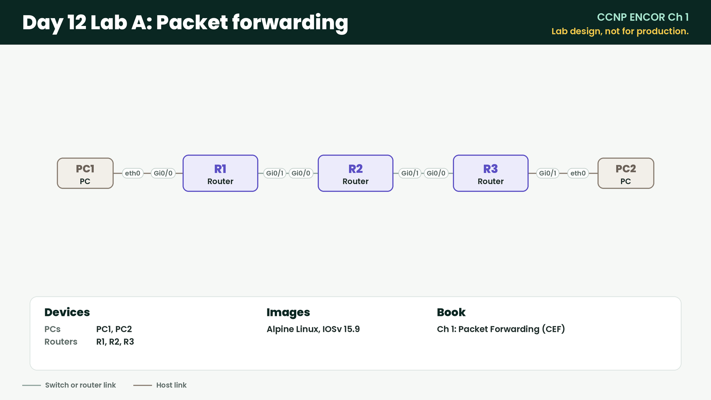

# Lab A · Work Order WO-1207

**From:** Network Architecture
**Project:** Branch to data centre routing, phase 1

## Topology

## Design

- Branch LAN `10.1.1.0/24` on R1.
- Data centre LAN `10.3.3.0/24` on R3.
- Transit links: R1–R2 `10.12.0.0/30`, R2–R3 `10.23.0.0/30`.
- Static routing only.
- R1 and R3 (edge): one default route toward R2.
- R2 (core): specific routes to both LANs.

## Addressing plan

| Node | Interface | IP address     | Connects to              |
|------|-----------|----------------|--------------------------|
| PC1  | eth0      | 10.1.1.10/24   | R1 Gi0/0 · gw 10.1.1.1   |
| R1   | Gi0/0     | 10.1.1.1/24    | PC1 · branch LAN         |
| R1   | Gi0/1     | 10.12.0.1/30   | R2 Gi0/0                 |
| R2   | Gi0/0     | 10.12.0.2/30   | R1 Gi0/1                 |
| R2   | Gi0/1     | 10.23.0.1/30   | R3 Gi0/0                 |
| R3   | Gi0/0     | 10.23.0.2/30   | R2 Gi0/1                 |
| R3   | Gi0/1     | 10.3.3.1/24    | PC2 · data centre LAN    |
| PC2  | eth0      | 10.3.3.10/24   | R3 Gi0/1 · gw 10.3.3.1   |

## Tasks

1. **Routing:** build the design. PC1 and PC2 reach each other, tested from both PCs.
2. **R1 record:** routing entry, CEF entry and adjacency for `10.3.3.0/24`.
   - What does CEF hold that the routing table doesn't?
3. **R2 validation:** clear R3's ARP entry. Record CEF for that next hop, restore forwarding, record it again.
4. **R2 test:** process switch traffic from R1. Prove the switching path, then restore it.
   - What would this do to a busy router?
5. **Hand-off:** one packet from PC1 to PC2, hop by hop. What changes and what stays the same?
6. **Design:** why does a switch use TCAM, and what does an SDM template control?

## Notes

- PCs are Alpine Linux, login `cisco` / `cisco`.
- On the PCs: `ip a`, `ip route`, `ping -c 3 10.3.3.10`, `traceroute 10.3.3.10`.
