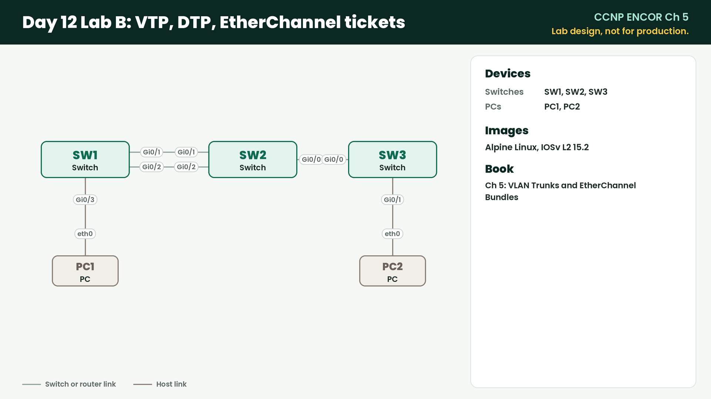

# Lab B · Tickets INC-2051, INC-2052

**From:** Network Operations
**Site:** Building A (SW1, SW2) and Building C (SW3)

## Topology

## Design

- User network VLAN 10 `USERS`: `10.10.10.0/24`.
- Server network VLAN 20 `SERVERS`.
- SW1–SW2 uplink: two links bundled as Port-channel 1.
- SW2–SW3: single link to Building C.
- PC1 in Building A on SW1. PC2 in Building C on SW3.

## Addressing plan

| Node | Interface    | IP address     | Connects to              |
|------|--------------|----------------|--------------------------|
| PC1  | eth0         | 10.10.10.1/24  | SW1 Gi0/3 · VLAN 10      |
| SW1  | Gi0/1, Gi0/2 | -              | SW2 Gi0/1, Gi0/2 · Po1   |
| SW1  | Gi0/3        | -              | PC1                      |
| SW2  | Gi0/1, Gi0/2 | -              | SW1 Gi0/1, Gi0/2 · Po1   |
| SW2  | Gi0/0        | -              | SW3 Gi0/0                |
| SW3  | Gi0/0        | -              | SW2 Gi0/0                |
| SW3  | Gi0/1        | -              | PC2                      |
| PC2  | eth0         | 10.10.10.2/24  | SW3 Gi0/1 · VLAN 10      |

## Tickets

1. **INC-2051** (P2): "New switch SW3 went in yesterday. I can't reach PC1 (10.10.10.1) in Building A. We're both on USERS."
   Change record: SW3 installed, connected to SW2, standard config.
2. **INC-2052** (P3, monitoring): "The SW1–SW2 uplink should be a two-link bundle. Only one link is in use."

For each ticket: symptom, what you checked, root cause, fix, proof. Find the cause before changing anything.

## Quick test

1. Spare port SW1 Gi0/0, still default: `switchport nonegotiate`. Accepted or error?
2. `switchport mode access`, then `switchport nonegotiate`. Accepted?
3. `show interfaces gi0/0 switchport`: check "Negotiation of Trunking".

## Notes

- PCs are Alpine Linux, login `cisco` / `cisco`.
- On the PCs: `ip a`, `ip route`, `ping -c 3 10.10.10.1`.
