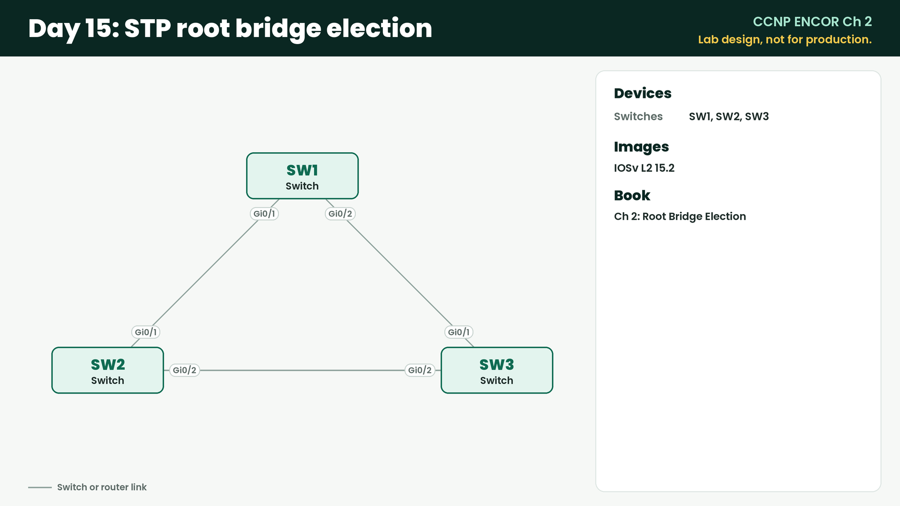

# Day 15 Lab · Work Order WO-1501

**From:** Network Operations
**Project:** Access block, spanning tree baseline

## Topology

## Design

- Three access switches cabled in a triangle, all links in VLAN 1.
- Spanning tree stays at the default mode.
- SW3 is the planned core of this block.

## Cabling

| Switch | Interface | Connects to |
|--------|-----------|-------------|
| SW1    | Gi0/1     | SW2 Gi0/1   |
| SW1    | Gi0/2     | SW3 Gi0/1   |
| SW2    | Gi0/2     | SW3 Gi0/2   |

## Tasks

1. **Baseline:** which switch is root for VLAN 1, and why did it win?
2. **Cost:** root path cost on SW1 and SW2. Where does each number come from?
3. **Ports:** role and state of every port. Which port blocks the unused link?
4. **Change:** make SW3 root for VLAN 1. Prove it from all three switches.
5. **Observe:** bounce a forwarding link on a non-root switch.
   - Which states does the port pass through, and how long until it forwards?

## Notes

- IOSv L2 switches in CML, console only.
- Import `lab-stp-root.yaml` into your own CML.
