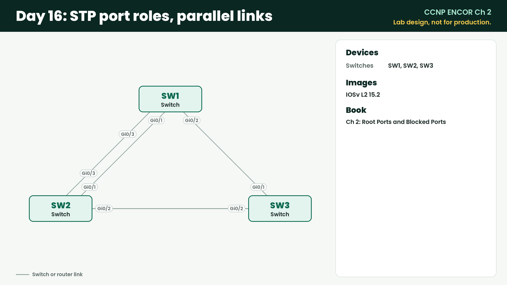

# Day 16 Lab · Work Order WO-1602

**From:** Network Operations
**Project:** Access block, spanning tree port audit

## Topology

## Design

- Three access switches cabled in a triangle, all links in VLAN 1.
- SW1 and SW2 are joined by two links for extra capacity.
- Spanning tree stays at the default mode.

## Cabling

| Switch | Interface | Connects to |
|--------|-----------|-------------|
| SW1    | Gi0/1     | SW2 Gi0/1   |
| SW1    | Gi0/2     | SW3 Gi0/1   |
| SW2    | Gi0/2     | SW3 Gi0/2   |
| SW1    | Gi0/3     | SW2 Gi0/3   |

## Tasks

1. **Bridge IDs:** record each switch's VLAN 1 bridge ID and split the priority into its parts.
   - Which switch is root, and what decided it?
2. **Root ports:** root port and root path cost on each non-root switch.
3. **Parallel links:** role and state at both ends of both SW1-SW2 links.
   - What decided each one?
4. **Designated ports:** which switch owns the designated port on each link, and why?
5. **Observe:** shut the forwarding SW1-SW2 link, then bring it back.
   - What does the other link do, and how long until it forwards?

## Notes

- IOSv L2 switches in CML, console only.
- Import `lab-stp-ports.yaml` into your own CML.
