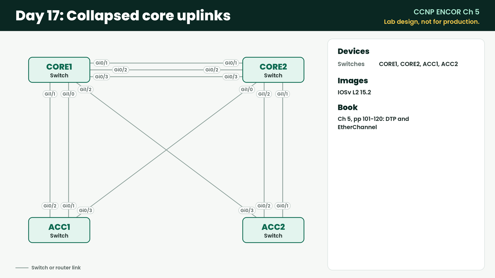

# Day 17 Lab Day · Chapter 5: Collapsed Core Uplinks

**Session:** Saturday 2026-10-31, 5:00 to 8:00 AM PT (live)
**CML lab:** import [`lab-ch05.yaml`](lab-ch05.yaml).
**Blueprint:** 3.1.a trunking, 3.1.b EtherChannel
**Book:** Chapter 5, pp 101-120: DTP and EtherChannel

## The job

A new floor comes online. Closet switches **ACC1 (Closet 2A)** and **ACC2 (Closet 3B)** uplink to both core switches, **CORE1** and **CORE2**, so one failure can't take the floor down. All four switches are at factory settings (hostname only).

**Plan:** Session 1: WO-1701 tasks 1-7. Session 2: WO-1701 tasks 8-11, WO-1702 tasks 1-4. Session 3: WO-1702 tasks 5-12.

## Topology

| Cable | From | To | Purpose |
|---|---|---|---|
| 1-3 | CORE1 Gi0/1, Gi0/2, Gi0/3 | CORE2 Gi0/1, Gi0/2, Gi0/3 | Core interlink |
| 4-5 | CORE1 Gi1/0, Gi1/1 | ACC1 Gi0/1, Gi0/2 | Closet 2A uplink to CORE1 |
| 6 | CORE2 Gi1/0 | ACC1 Gi0/3 | Closet 2A uplink to CORE2 |
| 7 | CORE1 Gi1/2 | ACC2 Gi0/3 | Closet 3B uplink to CORE1 |
| 8-9 | CORE2 Gi1/1, Gi1/2 | ACC2 Gi0/1, Gi0/2 | Closet 3B uplink to CORE2 |

## VLAN plan (all switches)

| VLAN | Name | Notes |
|---|---|---|
| 10 | DATA | |
| 20 | VOICE | |
| 99 | MGMT | |
| 999 | NATIVE-UNUSED | Native VLAN on every trunk, no users |

**Trunk standard:** every switch-to-switch link is an 802.1Q trunk carrying only VLANs 10, 20 and 99, native VLAN 999. When done, no uplink negotiates with DTP.

## Notes

- VTP is transparent on all four switches. Create the VLANs on each switch yourself.
- Trunk encapsulation starts as "auto" (these switches also do ISL), so IOS refuses `switchport mode trunk` until it's 802.1Q. Catalyst 9000 switches are 802.1Q only.
- MACs are fixed, so the STP root is the same on every boot.

---

## WO-1701 · Trunks and DTP

1. **VLANs:** create the VLAN plan on all four switches.
2. **Out of the box:** record the administrative and operational mode of ACC1 Gi0/3 and CORE2 Gi1/0.
   - Is this uplink a trunk? Why not?
3. **One side negotiates:** make the ACC1-CORE2 uplink a trunk by changing **only ACC1**, with DTP (not static).
   - Which encapsulation did they agree on? What does "n-" in front of it mean?
4. **802.1Q, still negotiated:** keep DTP on this uplink but run 802.1Q on both ends. Record the Encapsulation column.
5. **Static meets default:** CORE1 Gi1/2 (toward ACC2) becomes a static trunk. ACC2 Gi0/3 stays at its default.
   - What is ACC2's operational mode, and why?
6. **Stop DTP on one side:** stop CORE1 Gi1/2 sending DTP. Check ACC2 Gi0/3 each minute for 5 minutes. Then make this uplink a trunk with **no DTP on either end**.
   - When did its mode change, and what did the logs say? Why not straight away?
7. **Trunk standard:** apply it to both single uplinks (ACC1-CORE2 and CORE1-ACC2).
   - What does each of the four sections of `show interfaces trunk` show for these ports?
8. **Native VLAN mismatch:** on CORE2 Gi1/0 only, set the native VLAN back to default. Wait 2 minutes, then fix it.
   - Which protocol found the problem, and what did STP do?
9. **Allowed VLAN mismatch:** on ACC1 Gi0/3 only, remove VLAN 20 from the allowed list. Then fix it.
   - Does any protocol warn you? What would voice users notice?
10. **The replacement switch:** give ACC1 and CORE2 different VTP domain names, set both uplink ends to negotiate actively, and bounce the link. Then match the domains and return the uplink to the trunk standard.
    - Does the trunk come up? What does the log say?
11. **Open question (labs-to-test):** does `switchport nonegotiate` work on a port still in a dynamic mode? Test on an unused ACC2 port (e.g. Gi2/0).
    - What exactly does IOS say? Where does it work?

---

## WO-1702 · EtherChannel

**Design:** all three bundles are trunks built to the trunk standard.

| Bundle | Where | Members | Protocol | Rule |
|---|---|---|---|---|
| Po1 | CORE1-CORE2 | 3 | LACP | CORE1 starts, CORE2 only answers |
| Po13 | ACC1-CORE1 | 2 | PAgP | ACC1 starts, CORE1 only answers. ACC1 bundles only after it hears PAgP |
| Po24 | ACC2-CORE2 | 2 | none (static) | no negotiation protocol |

1. **Build Po1, Po13 and Po24.** Record port-channel flags, member flags and bandwidth for each.
2. **Neighbors:** show CORE1's LACP and PAgP neighbors.
   - What does each show that `show etherchannel summary` doesn't?
3. **STP view:** find the VLAN 10 root.
   - Which uplink forwards and which blocks on each closet switch?
   - How many STP ports does CORE1 see toward CORE2, and at what cost?
4. **Both sides only answer:** change CORE1's Po1 members so both ends only answer. Then restore the design.
   - What happens to Po1 and its members? What did STP do with the closet uplinks meanwhile?
5. **Member mismatch (LACP):** on CORE2, change the allowed VLANs on **one Po1 member** (not the port channel). Then fix it.
   - What flags and logs show on both cores?
6. **Member mismatch (static):** same on one ACC2 member of Po24. Then fix it.
   - Which bundle protects you? What could happen to traffic on the other?
7. **Maximum links:** allow only **two** active members in Po1, set on CORE1.
   - Which member is left out, and what flag does it show on **each** core? Why that one? Did Po1 stay up?
8. **Choose the standby link:** make CORE1 Gi0/3 active instead, keeping the maximum. Then make **CORE2** decide which members are active, with its own preference. Remove the maximum when done.
   - Which member is standby now, and how does that prove which switch decides?
9. **Platform check:** try LACP fast and a minimum number of links on Po1.
   - What exactly does this image say?
10. **Load balancing:** what hash does CORE1 use for non-IP, IPv4 and IPv6?
    - Which of the book's hash options does this image offer?
    - Why is a MAC-based hash bad toward a router? Why do 3 members balance worse than 2 or 4?
11. **Member failure:** check the LACP and PAgP counters, then shut CORE2 Gi0/2. Check Po1 on **both** cores, then CORE1 every 30 seconds until it changes. Bring the member back.
    - What happens to Po1's bandwidth, line protocol and STP cost?
    - How long did CORE1 take to notice, and what told it? (In CML the far end stays up.)
    - Why is a bundle better than three separate links?
12. **Uplink failure:** shut ACC1's Po13. Then bring it back.
    - Does Closet 2A stay connected? Which port takes over, and how fast?

---

## Wrap-up questions

- Which DTP mode combinations form a trunk, and which don't?
- Which EtherChannel mode combinations form a bundle, and which don't?
- Which settings must match on every member of a port channel?
- Why does the trunk standard turn DTP off on uplinks?
- What didn't this switch image support?
