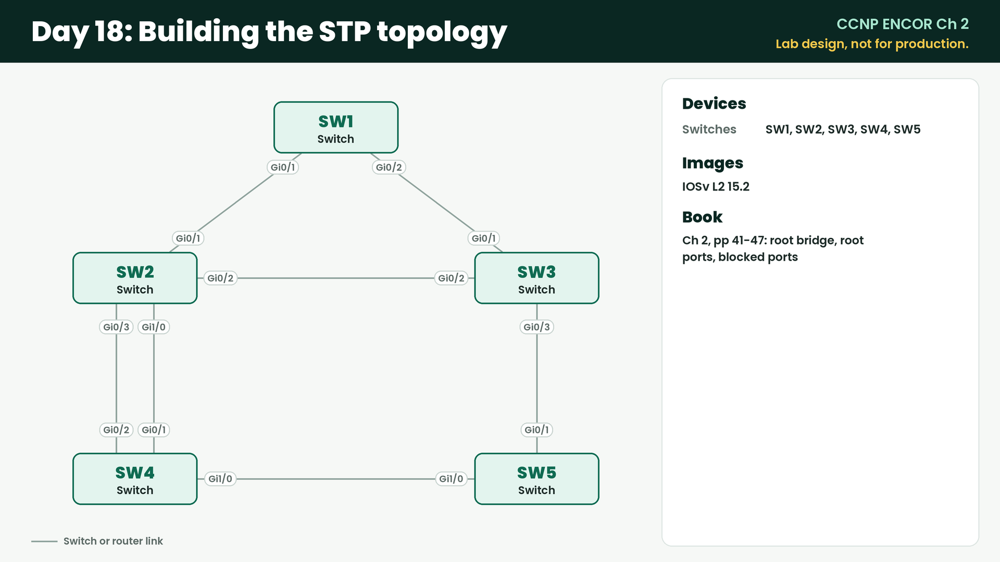

# Day 18 Lab · Chapter 2: Building the STP Topology

**Session:** Monday 2026-11-02, live, after the reading
**CML lab:** import [`lab-ch02-stp-topology.yaml`](lab-ch02-stp-topology.yaml).
**Blueprint:** 3.1.c Spanning tree (RSTP, MST) and enhancements
**Book:** Chapter 2, pp 41-47: root bridge, root ports, blocked ports

## The job

Five switches cabled like the book's Figure 2-1, with different MACs. Trunks carry VLANs 1 and 10. Spanning tree is
at its defaults.

## Topology

All links are 1 Gbps.

| Switch | System MAC |
|---|---|
| SW1 | 5254.0011.0011 |
| SW2 | 5254.0013.0013 |
| SW3 | 5254.0012.0012 |
| SW4 | 5254.0015.0015 |
| SW5 | 5254.0014.0014 |

## Notes

- Classic PVST+ (`spanning-tree enabled protocol ieee`), not the book's RSTP examples. Root and blocked-port logic is the same.
- Unused ports are shut, so `show spanning-tree` lists only cabled ports.
- MACs are fixed, so every boot gives the same result.

---

## WO-1801 · Read the tree before you touch it

1. **Predict (no CLI):** from the topology and MAC table only, write down the root, each switch's root port and cost, and the blocked port on each non-root link.
2. **Root bridge:** check with `show spanning-tree root` on all five.
   - Why is VLAN 1 priority 32769 and VLAN 10 32778?
3. **Root ports:** SW4 has two equal-cost links to SW2. Which is its root port?
   - Which p 44 tie-breaker decided it, and whose port number counted?
4. **Blocked ports:** which port is Altn BLK on the SW2-SW3 and SW4-SW5 links? Prove it on both ends.
   - Which p 45 rule decided each?
5. **Move the root port:** make SW4 use Gi0/1. No cost changes, no shutting ports. Try it on SW4 first.
   - Where did the change have to go, and why?
6. **Clean up:** restore the original root ports and blocked ports.
