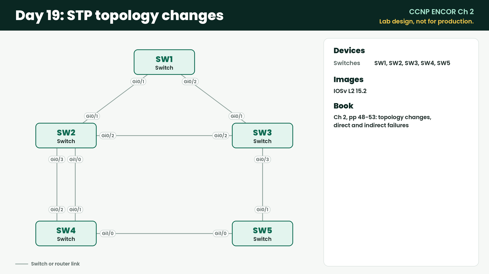

# Day 19 Lab · Chapter 2: STP Topology Changes

**Session:** Thursday 2026-11-05, live, after the reading
**CML lab:** import [`lab-ch02-stp-changes.yaml`](lab-ch02-stp-changes.yaml). Same five switches as Day 18.
**Blueprint:** 3.1.c Spanning tree (RSTP, MST) and enhancements
**Book:** Chapter 2, pp 48-53: topology changes, direct and indirect failures

## The job

Before the Day 18 design goes live, operations wants to know what each link failure costs: who notices, what gets
reported, and how long each switch has no path to the root. Everything is at its defaults.

## Topology

| Switch | System MAC |
|---|---|
| SW1 | 5254.0011.0011 |
| SW2 | 5254.0013.0013 |
| SW3 | 5254.0012.0012 |
| SW4 | 5254.0015.0015 |
| SW5 | 5254.0014.0014 |

## Notes

- Classic PVST+ (`spanning-tree enabled protocol ieee`) with the book's 802.1D timers.
- In CML, shutting one end of a link leaves the far end up. It just stops hearing BPDUs.
- Restore each failure and let the tree settle before the next.

---

## WO-1901 · What does each failure cost?

1. **One interface:** on SW4, spanning tree for Gi0/2 only, then the detailed view.
   - Which switch and port send the BPDUs SW4 uses on Gi0/2?
   - Compare BPDUs sent and received on Gi0/2 and Gi0/1. Why does SW4 send almost none?
2. **Baseline:** on SW1, SW2 and SW3, record VLAN 1's topology change count, time since the last one, and its interface.
3. **Failure A, between two non-root switches:** take the SW2-SW3 link down from SW3's end. Bring it back and time SW3's port.
   - Did any switch lose its path to the root? Which counters moved, and where did SW1's last change come from?
4. **Failure B, direct:** take SW2's root port down on SW2. Time how long until SW2 forwards toward the root. Restore.
   - Which book scenario is this, and why didn't SW2 wait for max age?
5. **Failure C, indirect:** shut SW1's port toward SW2, on SW1 only. Time it. Restore.
   - How does SW2 find out? Compare with failure B.

**Extra, after the stream:** take SW3's root port down on SW3 and time it. Restore.
- Which port changes state on which switch? Why is it slower than failure B? Which book scenario matches?
