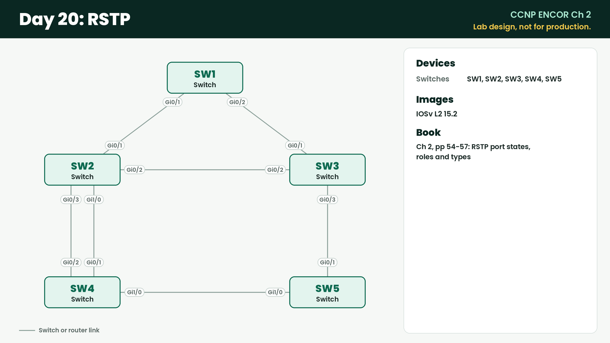

# Day 20 Lab · Chapter 2: RSTP

**Session:** Friday 2026-11-06, live, after the reading
**CML lab:** import [`lab-ch02-rstp.yaml`](lab-ch02-rstp.yaml). Same five switches as Day 18.
**Blueprint:** 3.1.c Spanning tree (RSTP, MST) and enhancements
**Book:** Chapter 2, pp 54-57: RSTP

## The job

Day 19 measured about 30 seconds for a direct failure and 50 for an indirect one. Move the same five switches to
Rapid PVST+ and measure the same failures again.

## Topology

| Switch | System MAC |
|---|---|
| SW1 | 5254.0011.0011 |
| SW2 | 5254.0013.0013 |
| SW3 | 5254.0012.0012 |
| SW4 | 5254.0015.0015 |
| SW5 | 5254.0014.0014 |

## Notes

- Priorities, costs and timers stay at their defaults.
- In CML, shutting one end of a link leaves the far end up. It just stops hearing BPDUs.
- Restore each failure and let the tree settle before the next.
- Predict first, then check.

---

## WO-2001 · What does Rapid PVST+ save?

1. **Migrate:** all five switches to Rapid PVST+.
   - Where does the switch confirm the protocol?
2. **Compare:** did the root, root ports or blocked ports change?
   - The book says RSTP has a discarding state. What do SW2's and SW4's non-forwarding ports show?
3. **Direct failure:** take SW2's root port down on SW2. Time how long until SW2 forwards toward the root. Restore.
   - Compare with Day 19's failure B. Which part of RSTP made the difference?
4. **Indirect failure:** shut SW1's port toward SW2, on SW1 only. Time it again. Restore.
   - Compare with Day 19's failure C and the book's RSTP number.
5. **A classic neighbor:** move SW5 back to classic PVST+ and time its root port. Then move it back to Rapid PVST+.
   - What does SW3 show on its port toward SW5? Which note in the book explains it?
