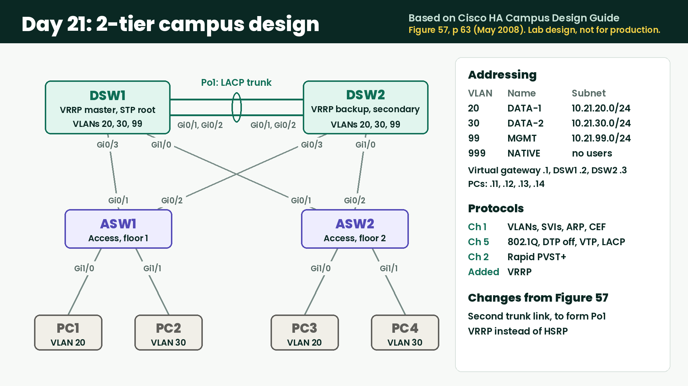

# Day 21 Lab Day: 2-Tier Campus Design



**Read the design:** [Cisco Campus Network for High Availability Design Guide (PDF, May 2008)](https://www.cisco.com/c/dam/en/us/td/docs/solutions/Enterprise/Campus/HA_campus_DG/hacampus-dg.pdf)

| Page | What's there |
|---|---|
| 63 | Figure 57, the design this lab uses |
| 3, 6 | Cisco's summary of best practices |
| 27-31 | Spanning tree versions and Rapid PVST+ |
| 33-36 | Trunks, VTP and DTP |
| 40-43 | EtherChannel |
| 44-49 | Gateway redundancy: HSRP, VRRP and GLBP |
| 64 | Figure 58, the design Cisco prefers |

**More from Cisco:** [Cisco Design Zone for Campus](https://www.cisco.com/c/en/us/solutions/design-zone/campus-branch.html) lists the current Cisco Validated Designs (CVDs) for campus networks, with their design and deployment guides.
The newer campus guide is the [Campus LAN and Wireless LAN Solution Design Guide](https://www.cisco.com/c/en/us/td/docs/solutions/CVD/Campus/cisco-campus-lan-wlan-design-guide.html).

**Session:** Saturday 2026-11-07, 5:00 to 8:00 AM PT (live). Replay: [YouTube](https://youtu.be/adt9stIzF8c)
**Blueprint:** 3.1.a trunking, 3.1.b EtherChannel, 3.1.c spanning tree, 3.3.c first hop redundancy
**Book:** Chapter 1 (forwarding, VLANs, SVIs, CEF), Chapter 2 (STP and RSTP), Chapter 5 (trunks, DTP, VTP, EtherChannel)
**Not from these chapters:** setting the root on purpose (Chapter 3) and VRRP

## The design

The layout comes from Figure 57, "Best Practice Topology for Spanning VLANs Across Access Layer Switches", on p 63 of Cisco's
[Campus Network for High Availability Design Guide](https://www.cisco.com/c/dam/en/us/td/docs/solutions/Enterprise/Campus/HA_campus_DG/hacampus-dg.pdf) (May 2008).
The looped layout also appears as Figure 13 in Cisco's newer
[Campus LAN and Wireless LAN Solution Design Guide](https://www.cisco.com/c/en/us/td/docs/solutions/CVD/Campus/cisco-campus-lan-wlan-design-guide.html).

Two changes from Figure 57:
- A second trunk link between the distribution switches, to form an EtherChannel.
- VRRP instead of HSRP.

**This is a learning design, not a production recommendation.** Cisco calls spanning VLANs across access switches a suboptimal
situation, and its guides prefer other designs. It's used here because it gives spanning tree real work to do.

## Topology

```
        DSW1 ===== Po1 ===== DSW2
         |  \               /  |
         |    \           /    |
         |      \       /      |
         |        \   /        |
         |        /   \        |
         |      /       \      |
         |    /           \    |
         |  /               \  |
        ASW1                 ASW2
        /  \                 /  \
      PC1  PC2             PC3  PC4
```

| Device | Port | Connects to | Purpose |
|---|---|---|---|
| DSW1 | Gi0/1, Gi0/2 | DSW2 Gi0/1, Gi0/2 | Trunk bundle |
| DSW1 | Gi0/3 | ASW1 Gi0/1 | Uplink |
| DSW1 | Gi1/0 | ASW2 Gi0/1 | Uplink |
| DSW2 | Gi0/3 | ASW1 Gi0/2 | Uplink |
| DSW2 | Gi1/0 | ASW2 Gi0/2 | Uplink |
| ASW1 | Gi1/0, Gi1/1 | PC1, PC2 | Access ports |
| ASW2 | Gi1/0, Gi1/1 | PC3, PC4 | Access ports |

## Addressing

| VLAN | Name | Subnet | Virtual gateway | DSW1 | DSW2 |
|---|---|---|---|---|---|
| 20 | DATA-1 | 10.21.20.0/24 | .1 | .2 | .3 |
| 30 | DATA-2 | 10.21.30.0/24 | .1 | .2 | .3 |
| 99 | MGMT | 10.21.99.0/24 | .1 | .2 | .3 |
| 999 | NATIVE-UNUSED | none | none | none | none |

| Host | VLAN | Address |
|---|---|---|
| PC1 | 20 | 10.21.20.11 |
| PC2 | 30 | 10.21.30.12 |
| PC3 | 20 | 10.21.20.13 |
| PC4 | 30 | 10.21.30.14 |
| ASW1 management | 99 | 10.21.99.11 |
| ASW2 management | 99 | 10.21.99.12 |

The PCs are already addressed. Spanning tree events and link changes show on the console with timestamps, with nothing to set up.

## Lab environment

| Item | Version |
|---|---|
| Cisco Modeling Labs (CML) | 2.9.1 (personal license) |
| Switches (DSW1, DSW2, ASW1, ASW2) | IOSv L2 image "IOSv L2 2020" (IOS 15.2) |
| PCs | Alpine Linux 3.21.3 |

## How to follow along

1. Import [`lab-campus-design.yaml`](lab-campus-design.yaml) into CML and start it. The switches take a few minutes to boot.
2. The cabling, the PC addresses and the console logging are already done. The switches have no other configuration, so you build every layer yourself.
3. Work through Steps 1 to 8 in order. Each step says what the network should do, not which commands to type.
4. Save the configs with `write memory` on all four switches before you stop the lab. If you wipe the lab, the configs are lost.

---

## The build

Predict each result before you check it, then answer each question.

### Step 1: Cabling
Confirm every link matches the table.

### Step 2: VLANs
The network doesn't share a VLAN database between switches. Create the VLANs on all four.
- Which VTP mode fits, and how do you confirm it?

### Step 3: Access ports
Put each PC in its VLAN.
- What does the switch show for each port before and after?

### Step 4: Trunks and EtherChannel
All switch-to-switch links are 802.1Q trunks that carry only VLANs 20, 30 and 99, with VLAN 999 as native and no trunk negotiation.
Bundle the two DSW1-DSW2 links with an open-standard protocol.
- Why would you turn off negotiation?
- How do you confirm the bundle formed, and with which protocol?
- Why does the native VLAN carry no users?

### Step 5: Spanning tree and routing
Run Rapid PVST+ everywhere. Make DSW1 the root for all three VLANs, with DSW2 as the backup.
- Who is the root before you change anything? Why?
- Predict every port role on all four switches before you set the root and after. Which ports block?
- What does the blocked port cost this design in bandwidth?

Add SVIs on DSW1 and DSW2 and turn on routing. Give the access switches their management addresses.
- Which routes appear, and where do they come from?

### Step 6: Gateway redundancy
Use VRRP so the virtual gateway stays up if a distribution switch fails. DSW1 is the master and DSW2 is the backup.
- Why does Figure 57 keep the root and the active gateway on the same switch?
- What would traffic do if they were on different switches?

### Step 7: Prove it works
Test every host against every other host, then trace how DSW1 forwards one packet between VLANs.
- What do the ARP table, CEF entry and adjacency show for that packet?

### Step 8: Break it

Read the on-screen logs for each failure and restore it before the next one.

| Test | Failure | Questions |
|---|---|---|
| Direct | Shut ASW1's active uplink on ASW1, with a ping running from PC1 to PC4 | Which port takes over, and how long does it take? How long do the pings fail? Why are those two times different? |
| Direct, again | Fix what you found, then repeat the failure | What changed for the PCs? |
| Indirect | Shut the same uplink on the DSW1 end | ASW1's port stays up. How does it find out, and how long does it take? |
| Bundle member | Shut one link in Po1 | Does spanning tree notice? Why or why not? |
| Whole switch | Stop DSW1 | Who becomes the root and the gateway? What do the PCs notice? |

### Wrap-up
- Which single failure hurts this design the most?
- What would you change before deploying this for a real company?

Save the configs before stopping the lab.

---

## What we found live: one EtherChannel member couldn't carry traffic alone

During Step 8 we tested each Po1 member on its own, with a ping running from PC1 to PC4 and the traffic forced across Po1.

| Shut on DSW1 | What Po1 showed | Traffic across Po1 |
|---|---|---|
| Gi0/2 (Gi0/1 left) | Up, Gi0/1 bundled | Worked, no problems |
| Gi0/1 (Gi0/2 left) | Up (`SU`). DSW2 showed Gi0/1 suspended `(s)` and Gi0/2 bundled `(P)` | Failed. DSW2 couldn't even ping DSW1's SVI. Worked again as soon as Gi0/1 came back up |

Both members have the same configuration, and LACP kept Gi0/2 in the bundle, so LACP messages were crossing that link.
Data wasn't. On paper an EtherChannel should survive losing either member, so this looks like the lab platform
(the CML link or the IOSv L2 image), not the design. **It isn't proven yet.** We'll test it off stream and update this page.

Two things to know if you try this in CML:
- **Shutting one end of a link leaves the far end up.** The far switch sees an indirect failure and only finds out
  through missed hellos. With LACP's default slow timers that takes about 90 seconds. A real cable pull brings both
  ends down at once. Shut both ends to act like a cable pull.
- **Fast LACP timers aren't available here.** `lacp rate fast` is rejected on this IOSv L2 image.

If you run this lab and see the same thing (or don't), open an issue and say which CML version and image you used.
