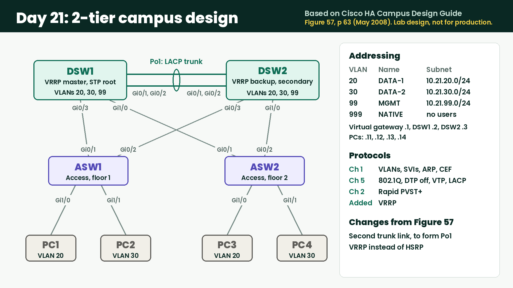

# Day 22 Lab Day: Fix the 2-Tier Campus

**Session:** moved from Sunday 2026-11-08, new date to come, live
**Network:** same lab as Day 21. Design, cabling and addressing: [Day 21 sheet](../day21/lab-campus-design.md).
**Blueprint:** 3.1.a trunking, 3.1.b EtherChannel, 3.1.c spanning tree, 3.3.c first hop redundancy
**Book:** Chapter 1 (VLANs, SVIs), Chapter 2 (STP and RSTP), Chapter 5 (trunks and EtherChannel)

## Topology

Same campus as Day 21:

## The situation

Saturday's network worked. Overnight someone changed things, and six tickets came in. They describe symptoms only.

## How to work each ticket

1. Confirm the symptom.
2. Prove or rule out your first guess with one show command.
3. Find the cause and predict what the fix changes.
4. Fix it and confirm the symptom is gone.
5. Note the command that found it.

Any order. Some faults hide others.

---

## INC-2201 · PC3 can't reach anything
PC3 (10.21.20.13, ASW2) can't reach its gateway or any host. PC1, same subnet on the other access switch, is fine.

## INC-2202 · ASW2 can't be managed
The NOC can't reach ASW2 at 10.21.99.12. ASW1 at 10.21.99.11 answers.

## INC-2203 · Messages on two consoles
ASW1 and DSW2 keep logging messages about the link between them. No user complaints.

## INC-2204 · The bundle is half its size
The DSW1-DSW2 bundle runs at half capacity. Both cables are in and both ports are up.

## INC-2205 · The gateway moved
DSW1 should be the active gateway for every user VLAN. It lost that role for one VLAN. Nothing was down.

## INC-2206 · The design audit failed
In one VLAN the root and the active gateway are no longer on the same distribution switch (Figure 57's rule). Traffic still flows.

---

## When every ticket is closed

- Every PC reaches every PC and both virtual gateways.
- Both access switches answer on management.
- Re-run one Day 21 failure test. Does it still recover?
- Which ticket was hardest, and why?

`write memory` on all four switches before stopping the lab.
