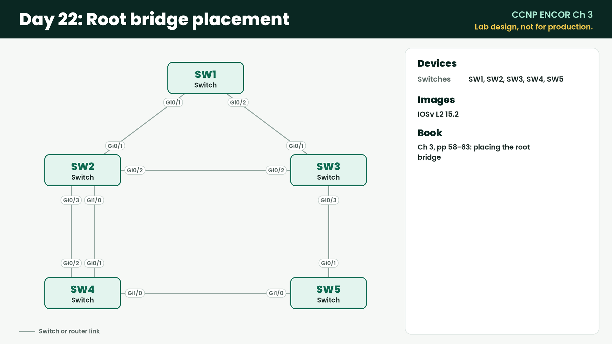

# Day 22 Lab · Chapter 3: Root Bridge Placement

**Session:** Monday 2026-11-09, live, after the reading
**CML lab:** import [`lab-ch03-root-placement.yaml`](lab-ch03-root-placement.yaml). Same five switches as Day 18, classic PVST+.
**Blueprint:** 3.1.c Spanning tree (RSTP, MST) and enhancements
**Book:** Chapter 3, pp 58-63: placing the root bridge

## The job

SW1 is root, but nobody chose it. Set the root and its backup on purpose, and find out how exposed VLAN 1 is to a
switch with a low priority.

## Topology

| Switch | System MAC |
|---|---|
| SW1 | 5254.0011.0011 |
| SW2 | 5254.0013.0013 |
| SW3 | 5254.0012.0012 |
| SW4 | 5254.0015.0015 |
| SW5 | 5254.0014.0014 |

## Notes

- VLAN 1 only. Leave VLAN 10 at its defaults.
- Predict first, then check.

---

## WO-2201 · Put the root where it belongs

1. **Why SW1?** Record the priority on SW1, SW2 and SW3.
   - Why is SW1 root right now?
2. **Primary and secondary:** SW1 primary root, SW2 secondary for VLAN 1, using the commands that pick the values for you.
   - What priority did each get, and what does the running config show?
   - Did a blocked port move? Why?
3. **A bad value:** on SW5, set VLAN 1's priority to 1000.
   - What does the switch say?
4. **A rogue switch:** set SW5's VLAN 1 priority to 4096.
   - Who is root for VLAN 1 now, and for VLAN 10? What are SW1's root port and root cost?
5. **Take it back:** run the primary root command on SW1 again.
   - What priority does it pick, and who wins? Compare with the book's note on the script.
6. **Path cost:** read the root cost on all five switches.
   - What does SW3 advertise, and what does SW5 add?
7. **Clean up:** remove SW5's rogue priority. Set SW1 and SW2 to the book's recommended primary and secondary values, then confirm the root.
