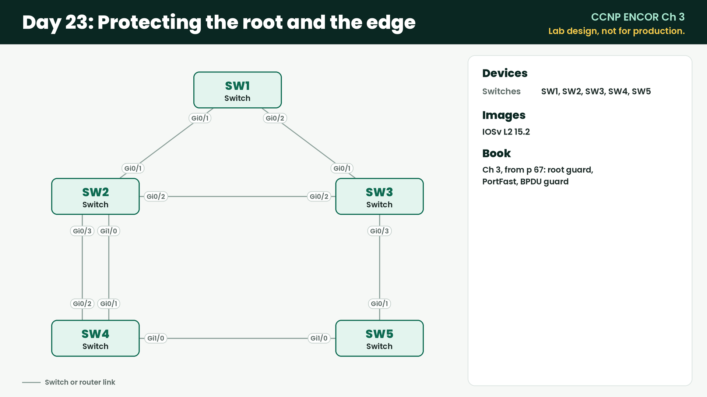

# Day 23 Lab · Chapter 3: Protecting the Root and the Edge

**Session:** Tuesday 2026-11-10, live, after the reading
**CML lab:** import [`lab-ch03-root-bpdu-guard.yaml`](lab-ch03-root-bpdu-guard.yaml). Starts where Day 22 ended (classic PVST+).
**Blueprint:** 3.1.c Spanning tree (RSTP, MST) and enhancements
**Book:** Chapter 3, from p 67: Additional STP Protection Mechanisms

## The job

Yesterday a switch at priority 4096 took over as root. The architect wants the root to stay in the core, and user
ports that come up fast but never accept a switch.

## Topology

SW5 is the outer switch. SW3 and SW4 are the switches it plugs into.

## Notes

- VLAN 1 unless a task says otherwise.
- Predict first, then check.

---

## WO-2301 · Keep the root in the core, keep switches off user ports

1. **Starting point:** root for VLAN 1 and VLAN 10, and the priority of SW1 and SW2.
   - Which ports on SW3 and SW4 face SW5?
2. **Keep the root in the core:** no switch behind SW3 or SW4 may ever become root. Configure SW3 and SW4 on the ports facing SW5, not SW5. Then set SW5's VLAN 1 priority to 4096.
   - What role and state do those ports show? Which command lists them?
   - Is SW1 still root?
3. **The rogue leaves:** remove SW5's priority.
   - Do the ports recover by themselves? How long, and what did the log say?
4. **A desk port:** SW4 Gi1/0 becomes a user port in VLAN 10. It forwards as soon as a PC plugs in and shuts itself if a switch connects. SW5 is still on the other end.
   - What happens, and why?
   - What did the switch warn you about? Which command shows why the port is down?
5. **Self-recovery:** ports shut by that protection come back after 30 seconds on their own.
   - When does Gi1/0 retry, and did it use your 30 seconds? What happens each time?
6. **Clean up:** SW4 Gi1/0 back to a trunk to SW5 with no edge settings, up, and every port in its task 1 role.

Run `write memory` only to keep the protections for the next lab.
