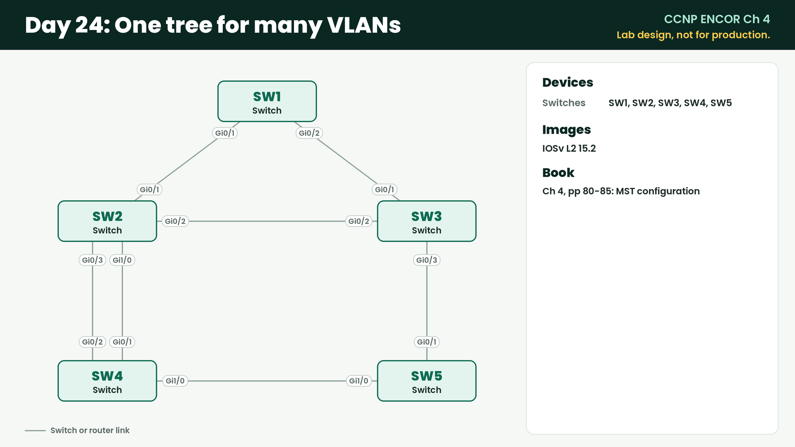

# Day 24 Lab · Chapter 4: One Tree for Many VLANs

**Session:** Wednesday 2026-11-11, live, after the reading
**CML lab:** import [`lab-ch04-mst-basics.yaml`](lab-ch04-mst-basics.yaml). Starts where Day 23 ended (classic PVST+), with VLANs 20, 30 and 40 added.
**Blueprint:** 3.1.c Spanning tree (RSTP, MST) and enhancements
**Book:** Chapter 4, pp 80-85: Multiple Spanning Tree Protocol, MST configuration

## The job

Five VLANs, five spanning trees. The architect wants two: VLANs 10 and 20 on one, VLANs 30 and 40 on the other,
each with its own root so both core uplinks get used.

## Topology

## Notes

- VLANs 10, 20, 30 and 40 on every switch. Every link is a trunk.
- Predict first, then check.

---

## WO-2401 · Fewer trees, two roots

1. **Starting point:** how many spanning-tree instances does SW3 run?
   - Who is root for VLAN 1 and for VLAN 30, and why?
2. **One region:** all five switches in MST region ENCOR, revision 1. Instance 1: VLANs 10, 20. Instance 2: VLANs 30, 40.
   - Which command shows the region settings?
   - How many instances does SW3 run now? Which instance holds VLAN 1?
3. **Two roots:** SW1 is root for instance 1, SW2 for instance 2, each backing up the other.
   - Which ports block in each instance? Same port for both?
4. **Look back:** compare with task 1.
   - How many trees does each switch run now, and how many sets of BPDUs does it send?

Run `write memory` only to keep MST for the next lab.
