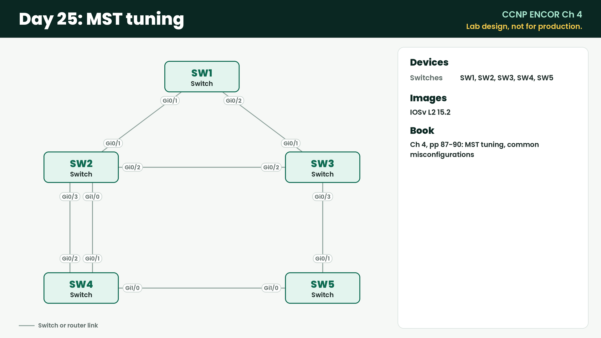

# Day 25 Lab · Chapter 4: MST Tuning

**Session:** Thursday 2026-11-12, live, after the reading
**CML lab:** import [`lab-ch04-mst-tuning.yaml`](lab-ch04-mst-tuning.yaml). Starts where Day 24 ended.
**Blueprint:** 3.1.c Spanning tree (RSTP, MST) and enhancements
**Book:** Chapter 4, pp 87-90: MST Tuning, Common MST Misconfigurations

## Topology

## Notes

- Region ENCOR, revision 1. Instance 1: VLANs 10, 20. Instance 2: VLANs 30, 40.
- SVIs on SW2 / SW3: VLAN 30 10.30.0.2 / .3, VLAN 40 10.40.0.2 / .3.
- If an SVI shows down after import, bounce it once (IOSv L2 quirk).
- Predict first, then check.

---

## WO-2501 · Use both of SW4's uplinks

1. **Split by instance:** instance 2 uses SW4 Gi0/1, instance 1 stays on Gi0/2. Change SW4 only.
   - How do you prove instance 1 didn't move?
2. **Other side:** instance 1 must also use SW4 Gi0/1. Don't touch SW4.
   - Why does this work from the far end, when task 1 had to be on SW4?

## INC-2502 · NOC ticket

> **Reported:** 05:40 by monitoring, priority 3
> **Symptom:** Since last night's change window, the SW3 probe (10.30.0.3) can't reach 10.30.0.2 on SW2.
> The VLAN 40 probe (10.40.0.3 to 10.40.0.2) is fine. Change record: "trunk tidy-up for load balancing".

3. Find the cause and fix it.
   - What rule would have stopped this change from breaking anything?

Run `write memory` only to keep today's changes for the next lab.
