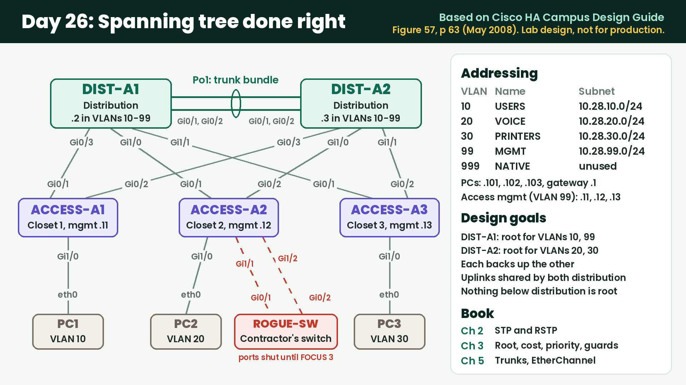

# Day 26 Lab Day: Spanning Tree Done Right

**Session:** Saturday 2026-11-14, 5:00 to 8:00 AM PT (live)
**CML lab:** import [`lab-ch03-stp-best-practice.yaml`](lab-ch03-stp-best-practice.yaml) (CML title "Day 26 - Lab: Ch 3 STP best practice"). It boots with hostnames, cabling and console logging only.
**Blueprint:** 3.1.c Configure and verify common Spanning Tree Protocols (RSTP, MST) and Spanning Tree enhancements such as root guard and BPDU guard
**Book:** Chapter 2 (STP and RSTP), Chapter 3 (root placement, cost and priority, root guard, PortFast, BPDU guard, error recovery, BPDU filter, loop guard, UDLD). Trunks and EtherChannel from Chapter 5.
**Read the design:** [Cisco Campus Network for High Availability Design Guide (PDF, May 2008)](https://www.cisco.com/c/dam/en/us/td/docs/solutions/Enterprise/Campus/HA_campus_DG/hacampus-dg.pdf)

| Page | What's there |
|---|---|
| 6 | Cisco's summary of Layer 2 recommendations |
| 31-32 | Root guard, BPDU guard and loop guard |
| 39 | UDLD |
| 45 | Why the root and the active gateway belong on the same switch |
| 63 | Figure 57, the design this lab uses |

## The job

Building A runs VLANs across all three closets, so spanning tree carries real weight here. Last month a contractor
plugged a switch into a desk port and the closet went down for an hour. The architect wants Building A rebuilt to
Cisco's spanning tree recommendations: the root chosen on purpose, the uplinks shared between the two distribution
switches, and protection against anything someone plugs in.

You start from switches with only hostnames, cabling and console logging. `ROGUE-SW` is already set up the way the
contractor's switch was. Leave it alone until FOCUS 3.

## Topology

| Device | Port | Connects to | Purpose |
|---|---|---|---|
| DIST-A1 | Gi0/1, Gi0/2 | DIST-A2 Gi0/1, Gi0/2 | Link between the distribution switches |
| DIST-A1 | Gi0/3, Gi1/0, Gi1/1 | ACCESS-A1, A2, A3 Gi0/1 | Downlinks |
| DIST-A2 | Gi0/3, Gi1/0, Gi1/1 | ACCESS-A1, A2, A3 Gi0/2 | Downlinks |
| ACCESS-A1, A2, A3 | Gi1/0 | PC1, PC2, PC3 | User ports |
| ACCESS-A2 | Gi1/1 | ROGUE-SW Gi0/1 | A desk port in closet 2 |
| ACCESS-A2 | Gi1/2 | ROGUE-SW Gi0/2 | A spare uplink port in closet 2, for a future switch |

## Addressing

| VLAN | Name | Subnet | DIST-A1 | DIST-A2 |
|---|---|---|---|---|
| 10 | USERS | 10.28.10.0/24 | .2 | .3 |
| 20 | VOICE | 10.28.20.0/24 | .2 | .3 |
| 30 | PRINTERS | 10.28.30.0/24 | .2 | .3 |
| 99 | MGMT | 10.28.99.0/24 | .2 | .3 |
| 999 | NATIVE-UNUSED | none | none | none |

| Host | VLAN | Address |
|---|---|---|
| PC1 (ACCESS-A1) | 10 | 10.28.10.101 |
| PC2 (ACCESS-A2) | 20 | 10.28.20.102 |
| PC3 (ACCESS-A3) | 30 | 10.28.30.103 |
| ACCESS-A1, A2, A3 management | 99 | 10.28.99.11, .12, .13 |

The PCs are already addressed, with .1 as their gateway (that's for the optional extra at the end). Spanning tree
events show on every switch console with timestamps, with nothing to set up.

---

## FOCUS 1 · Build the tree on purpose (5:00-5:55)

1. **Before you touch anything (5 min):** Which switch is the root for VLAN 1 right now, and why that one? Is that
   where you'd want it?
2. **VLANs and trunks (15 min):** Create the VLANs on all five switches without sharing a VLAN database. Every
   switch-to-switch link is a trunk that carries only VLANs 10, 20, 30, 99 and 999, uses VLAN 999 as native, and
   never negotiates. Bundle the two links between the distribution switches with an open-standard protocol.
   - What does Cisco say on p 6 about trunk negotiation, and what does it save you?
3. **Rapid PVST+ (5 min):** Run Rapid PVST+ on every switch.
4. **Predict, then place the roots (20 min):** DIST-A1 must be the root for VLANs 10 and 99, DIST-A2 for VLANs 20
   and 30, and each must take over the other's VLANs if it fails. Before you configure anything, write down every
   port role on ACCESS-A3 for VLAN 10 and for VLAN 20. Then build it and check.
   - What priority did each switch end up with, and where does the extra number in the bridge ID come from?
   - Which uplink does each closet use for VLAN 10, and which for VLAN 20? What does that buy you?
5. **Management (5 min):** Give each switch its address in VLAN 99, and the distribution switches their addresses in
   VLANs 10, 20 and 30. Prove each PC can reach both distribution switches.

## FOCUS 2 · Steer it, then lock it down (6:00-6:55)

6. **Move a blocked port (15 min):** The VLAN 10 uplink from ACCESS-A3 to DIST-A1 is getting new optics next week.
   Until then, ACCESS-A3 must send VLAN 10 up through DIST-A2, while DIST-A1 stays the root and VLAN 20 doesn't move.
   - What changed, on which switch, and why does it only affect VLAN 10?
   - Port priority is the other tool from Chapter 3. Where in this topology would it be the right one, and why not here?
   - Put it back when you're done.
7. **User ports (15 min):** PCs must get a working port right away, without waiting for spanning tree. A switch
   plugged into any user port must be shut down automatically, and the port must come back by itself once the
   switch is gone.
   - Why does Cisco say on p 32 that this tool needs "operator intervention or the setting of error recovery"?
8. **Protect the root (15 min):** Nothing plugged in below the distribution layer may ever take over as root, even
   on a port that's meant to connect a switch.
   - Which ports did you protect, and why there and not on the access switches?
   - Check every VLAN that crosses those ports, not only the user VLANs. Is anything blocked that shouldn't be?
9. **BPDU filter (5 min, no config):** Cisco doesn't recommend BPDU filter for this design. What would it do on a
   user port that BPDU guard doesn't, and why is that dangerous?

## FOCUS 3 · Soft failures, then try to break it (7:00-7:55)

10. **Silent failures (10 min):** If a link stays up but stops carrying BPDUs, a blocked port must not start
    forwarding. Protect every port where that could happen.
    - Which ports did you pick, and why can't it go on the same port as task 8's protection?
11. **One-way links (5 min):** Cisco recommends protection against links that only work in one direction (p 39).
    Turn it on for every switch-to-switch link and show its neighbors.
    - CML links can't fail in one direction. What would you expect to see if one did?
12. **The contractor's switch, on a desk port (10 min):** Bring up ROGUE-SW Gi0/1. What happens on ACCESS-A2, and
    what does the log say? Wait 30 seconds. Then shut ROGUE-SW Gi0/1 again and watch the port.
13. **The contractor's switch, on the spare uplink (10 min):** Bring up ROGUE-SW Gi0/2. Who is the root now, from
    ACCESS-A2's point of view and from the distribution switches'? Can PC2 still reach its gateway addresses? Can PC1?
    - Did the protection work? What did it cost closet 2?
    - Shut ROGUE-SW Gi0/2 again. How long until everything recovers?
14. **A silent failure (10 min):** On DIST-A2 Gi1/1 only, stop BPDUs being sent with BPDU filter. What does ACCESS-A3
    do with its Gi0/2, and what would it have done without task 10? Remove the filter.
15. **Save (2 min):** `write memory` on all five Building A switches. Sunday's lab can start from
    your configs.

**If there's time left:** give each VLAN a virtual gateway at .1 with gateway redundancy, active on the same switch
that's root for that VLAN. Why does Cisco want those two on the same switch (p 45)?
