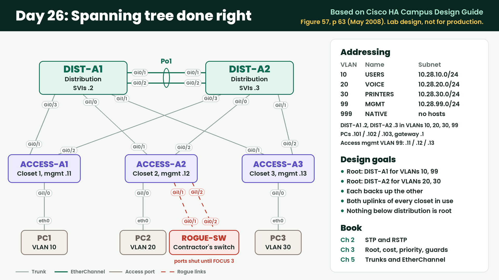

# Day 26 Lab Day: Spanning Tree Done Right

**Session:** Saturday 2026-11-14, 5:00 to 8:00 AM PT (live)

**CML lab:** import [`lab-ch03-stp-best-practice.yaml`](lab-ch03-stp-best-practice.yaml). Boots with hostnames, cabling and console logging only.

**Blueprint:** 3.1.c Spanning tree (RSTP, MST) and enhancements

**Book:** Chapters 2 and 3 (STP, RSTP, tuning and protection), Chapter 5 (trunks, EtherChannel)

**Read the design:** [Cisco Campus Network for High Availability Design Guide (PDF, May 2008)](https://www.cisco.com/c/dam/en/us/td/docs/solutions/Enterprise/Campus/HA_campus_DG/hacampus-dg.pdf)

| Page | What's there |
|---|---|
| 6 | Cisco's summary of Layer 2 recommendations |
| 31-32 | Root guard, BPDU guard and loop guard |
| 39 | UDLD |
| 45 | Why the root and the active gateway belong on the same switch |
| 63 | Figure 57, the design this lab uses |

## The job

Building A runs VLANs across all three closets. Last month a contractor's switch on a desk port took a closet down
for an hour. Rebuild Building A to Cisco's recommendations: root chosen on purpose, uplinks shared between both
distribution switches, and protection against anything plugged in.

`ROGUE-SW` is set up like the contractor's switch. Leave it alone until FOCUS 3.

## Topology

| Device | Port | Connects to | Purpose |
|---|---|---|---|
| DIST-A1 | Gi0/1, Gi0/2 | DIST-A2 Gi0/1, Gi0/2 | Link between the distribution switches |
| DIST-A1 | Gi0/3, Gi1/0, Gi1/1 | ACCESS-A1, A2, A3 Gi0/1 | Downlinks |
| DIST-A2 | Gi0/3, Gi1/0, Gi1/1 | ACCESS-A1, A2, A3 Gi0/2 | Downlinks |
| ACCESS-A1, A2, A3 | Gi1/0 | PC1, PC2, PC3 | User ports |
| ACCESS-A2 | Gi1/1 | ROGUE-SW Gi0/1 | A desk port in closet 2 |
| ACCESS-A2 | Gi1/2 | ROGUE-SW Gi0/2 | A spare uplink port in closet 2, for a future switch |

## Addressing

| VLAN | Name | Subnet | DIST-A1 | DIST-A2 |
|---|---|---|---|---|
| 10 | USERS | 10.28.10.0/24 | .2 | .3 |
| 20 | VOICE | 10.28.20.0/24 | .2 | .3 |
| 30 | PRINTERS | 10.28.30.0/24 | .2 | .3 |
| 99 | MGMT | 10.28.99.0/24 | .2 | .3 |
| 999 | NATIVE-UNUSED | none | none | none |

| Host | VLAN | Address |
|---|---|---|
| PC1 (ACCESS-A1) | 10 | 10.28.10.101 |
| PC2 (ACCESS-A2) | 20 | 10.28.20.102 |
| PC3 (ACCESS-A3) | 30 | 10.28.30.103 |
| ACCESS-A1, A2, A3 management | 99 | 10.28.99.11, .12, .13 |

PCs are pre-addressed with gateway .1 (for the extra at the end). Spanning tree events show on every console.

---

## FOCUS 1 · Build the tree on purpose

1. **Before you touch anything:** which switch is root for VLAN 1, and why? Is that where you want it?
2. **VLANs and trunks:** VLANs on all five switches, no shared VLAN database. Every switch-to-switch link is a trunk carrying only 10, 20, 30, 99 and 999, native 999, never negotiating. Bundle the two distribution links with an open-standard protocol.
   - What does Cisco say on p 6 about trunk negotiation, and what does it save?
3. **Rapid PVST+** on every switch.
4. **Predict, then place the roots:** DIST-A1 is root for VLANs 10 and 99, DIST-A2 for 20 and 30, each backing up the other. First write down every ACCESS-A3 port role for VLAN 10 and VLAN 20, then build and check.
   - What priority did each switch get? Where does the extra number in the bridge ID come from?
   - Which uplink does each closet use for VLAN 10 and for VLAN 20? What does that buy you?
5. **Management:** each switch gets its VLAN 99 address, the distribution switches their VLAN 10, 20, 30 addresses.
   - Prove each PC reaches both distribution switches.

## FOCUS 2 · Steer it, then lock it down

6. **Move a blocked port:** ACCESS-A3's VLAN 10 uplink to DIST-A1 gets new optics next week. Until then VLAN 10 goes up through DIST-A2. DIST-A1 stays root and VLAN 20 doesn't move. Put it back afterwards.
   - What changed, where, and why only VLAN 10?
   - Where would port priority be the right tool instead, and why not here?
7. **User ports:** PCs get a working port immediately. A switch on any user port gets shut down automatically, and the port recovers by itself once it's gone.
   - Why does Cisco say on p 32 this needs "operator intervention or the setting of error recovery"?
8. **Protect the root:** nothing below the distribution layer may ever become root, even on a port meant for a switch.
   - Which ports did you protect, and why there and not on the access switches?
   - Check every VLAN on those ports, not only user VLANs. Is anything blocked that shouldn't be?
9. **BPDU filter (no config):** Cisco doesn't recommend it here.
   - What would it do on a user port that BPDU guard doesn't, and why is that dangerous?

## FOCUS 3 · Soft failures, then try to break it

10. **Silent failures:** if a link stays up but stops carrying BPDUs, a blocked port must not start forwarding. Protect every port where that could happen.
    - Which ports, and why not on the same ports as task 8?
11. **One-way links:** turn on Cisco's one-way link protection (p 39) on every switch-to-switch link and show its neighbors.
    - CML links can't fail one way. What would you expect if one did?
12. **Contractor's switch, desk port:** bring up ROGUE-SW Gi0/1. Wait 30 seconds, then shut it and watch the port.
    - What happens on ACCESS-A2, and what does the log say?
13. **Contractor's switch, spare uplink:** bring up ROGUE-SW Gi0/2, then shut it again.
    - Who is root, from ACCESS-A2 and from the distribution switches?
    - Can PC2 reach its gateway addresses? Can PC1?
    - Did the protection work, and what did it cost closet 2? How long until everything recovers?
14. **A silent failure:** on DIST-A2 Gi1/1 only, stop BPDUs going out with BPDU filter. Then remove it.
    - What does ACCESS-A3 do with Gi0/2? What would it do without task 10?
15. **Save:** `write memory` on all five Building A switches. Sunday's lab can start from your configs.

**Extra:** give each VLAN a virtual gateway at .1 with gateway redundancy, active on that VLAN's root.
- Why does Cisco want those two on the same switch (p 45)?
