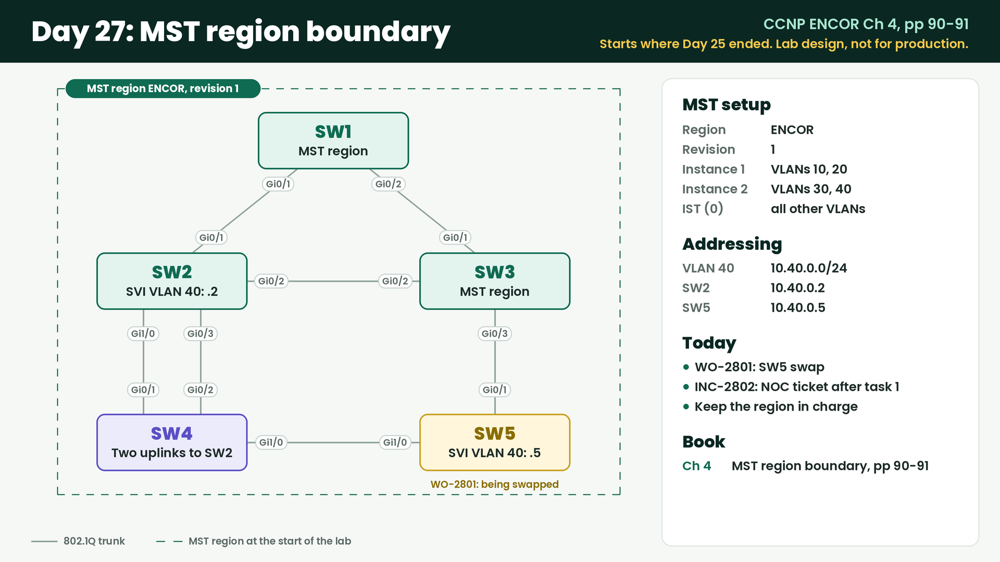

# Day 27 Lab · Chapter 4: MST Region Boundary

**Session:** Wednesday 2026-11-18, live, after the DIKTA catch-up
**CML lab:** import [`lab-ch04-mst-boundary.yaml`](lab-ch04-mst-boundary.yaml). Starts where Day 25 ended.
**Blueprint:** 3.1.c Spanning tree (RSTP, MST) and enhancements
**Book:** Chapter 4, pp 90-91: MST Region Boundary

## Topology

## Notes

- Region ENCOR, revision 1. Instance 1: VLANs 10, 20. Instance 2: VLANs 30, 40.
- VLAN 40 SVIs: SW2 10.40.0.2, SW5 10.40.0.5.
- In this lab a blocked port can still pass a ping. Trust STP state and logs, not ping.
- Predict first, then check.

---

## WO-2801 · SW5 swap

1. **Swap SW5:** the new SW5 runs Rapid PVST+ only. Make SW5 match it.
   - Which ports are now region boundary ports? Which output proves it?

> Work INC-2802 before task 2.

## INC-2802 · NOC ticket

> **Reported:** 05:50 by monitoring, priority 2
> **Symptom:** Since the SW5 change, SW3 and SW4 raise critical spanning-tree alarms on their ports toward SW5.
> Change record: "SW5 swap, no other changes".

2. Find the cause and fix it.
   - What must stay true on the PVST+ side so this can't happen again?

## WO-2801 (continued)

3. **Keep the region in charge:** the MST region must stay root for every VLAN on SW5, even if a new switch is added at default priority. Don't touch SW5.
   - Why does SW5 show the same root for every VLAN?

Run `write memory` only to keep today's changes for the next lab.
