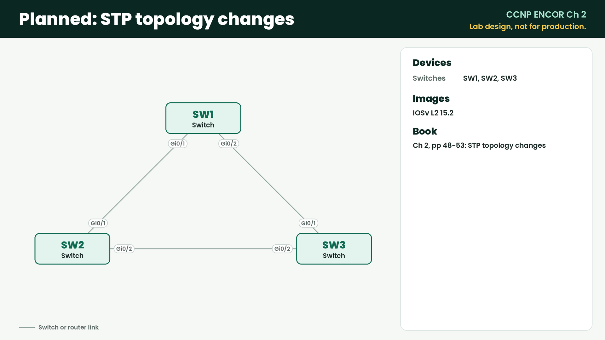

# Lab · Work Order WO-1601 (planned for the pp 48-53 session)

**From:** Network Operations
**Project:** Access block, spanning tree change monitoring

## Topology

## Design

- Same triangle of access switches as WO-1501.
- All three links are 802.1Q trunks. VLANs 1 and 10 on every switch.
- Spanning tree stays at the default mode.

## Cabling

| Switch | Interface | Connects to |
|--------|-----------|-------------|
| SW1    | Gi0/1     | SW2 Gi0/1   |
| SW1    | Gi0/2     | SW3 Gi0/1   |
| SW2    | Gi0/2     | SW3 Gi0/2   |

## Tasks

1. **Trunks:** build the design. Record the root and every root port for VLAN 1 and VLAN 10.
   - Are the two trees the same? Why?
2. **Change counter:** on every switch, record VLAN 1's topology change count, when the last one happened, and from which interface.
3. **Direct failure:** fail a forwarding link that touches the root.
   - Who notices, what do they send, and how long until traffic has a path again?
4. **Recovery:** restore the link and check the counters on all three switches.
   - Why do they differ?
5. **Question:** which failure made the switches age out MAC addresses faster, and for how long?

## Notes

- IOSv L2 switches in CML, console only.
- Import `lab-stp-changes.yaml` into your own CML.
