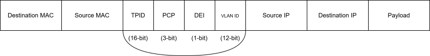

# Ch 1 - Packet Forwarding (clean notes)

Related: Ch 5 (VLAN Trunks and EtherChannel Bundles), Ch 6 (IP Routing Essentials)

<details>
<summary>What I got wrong in my raw notes</summary>

**Day 3**
- `show vlan` has **four** sections, not three: VLAN-to-port list, MTU, Remote SPAN VLANs, Private VLANs. (Three sections is `show interfaces trunk`.)
- Why VLANs: the book's main reasons are smaller broadcast domains and better use of switch ports. Security is a good extra reason but not the main one.

**Day 4**
- MAC table learns the **source** MAC of incoming frames. It then uses that table to forward to the **destination** MAC.
- CAM is the memory that *stores* the MAC table. It does not forward traffic by itself.
- CAM 1s and 0s: the book says 0 = true (match), 1 = false. I wrote it the other way. The point to remember: CAM is **binary** (match or no match), TCAM is **ternary** (match, no match, don't care).
- `show interfaces status` is the **Interface Status** command. The **Switch Port Status** command is `show interfaces <id> switchport`.
- "layer 3 forwarding comes before layer 3" should be **before layer 2**.
- ARP maps **Layer 3 (IP) to Layer 2 (MAC)**, not the other way round.

**Day 5**
- Connected routes have an **administrative distance (AD)** of 0, not "administrative value".
- The interface has to be **operationally up** (up/up), not just administratively up, before its network goes in the RIB.
- IPv6 example: `ipv6 address 2001:db8:10::254/64`, not `x.x.x.x/64`. No `secondary` keyword needed for IPv6.
- Packet routing: these are three ways a host/router **learns the next hop** (static route, default gateway, routing protocol), not three ways to route a packet.
- The router rewrites the **MAC addresses** at every hop. The **IP addresses stay the same** end to end.
- SVI to core / ISP: it works, but the book's point is to use a **routed switch port** for point-to-point links instead of a transit VLAN + SVI.

**Day 7**
- CEF was built so routers can handle **larger packet volumes** (more packets), not larger packets.
- Modern routers **rewrite** the Layer 2 header. Only the first Cisco routers removed and re-added it.

**May notes and flashcards**
- Static MAC entries: the book's use case is old load balancers (stop unknown unicast flooding). Stopping MAC spoofing is port security, a different feature.
- Flashcard Q5: VLAN 1 **cannot be VTP pruned** (prune-eligible range is 2-1001). If VLAN 1 is missing from the forwarding line, it's STP blocking.
- DEI note: collisions don't happen on full-duplex switch links. Contention causes drops and delay, not collisions.

</details>

---

## Network Device Communication

Almost everything today runs on TCP/IP, which is based on the 7-layer OSI model. An application creates data at Layer 7 and the host sends it **down** the stack. At Layer 3 the host decides: is this for me (go back up) or for another device (keep going down to Layer 1). The receiving device goes **up** the stack from Layer 1 to 7.

- First Layer 2 devices: bridges and switches. First Layer 3 devices: routers.
- ASICs made it possible to forward in hardware. That led to **multilayer switches (MLS)**: switch at Layer 2 in hardware and route at Layer 3.

### Layer 2 Forwarding
A **MAC address** is 48 bits, written as 6 hex octets. First 3 octets = **OUI** (manufacturer). Last 3 = unique per device.
A host only moves a frame up to Layer 3 if the destination MAC is its own, or the broadcast **FF:FF:FF:FF:FF:FF**. Broadcasts stop at a Layer 3 boundary.

### Collision Domains
**Key Topic:** A **collision domain** is a segment where a device can hear another device transmitting. Ethernet uses **CSMA/CD** so only one device talks at a time, which means **half duplex**.
- Old coax (10BASE-2, 10BASE-5) and **hubs** made collision domains bigger. A hub just repeats traffic out every port.
- A **switch** keeps a MAC table and only sends traffic to the port where the destination lives. Every port becomes its own collision domain, so devices can run **full duplex**.

**Unknown unicast flooding:** destination MAC not in the table, so the switch floods out every port except the one it came in on.
**Broadcast:** goes out every port in the VLAN. Too many broadcasts slow down unicast traffic. All devices in the same Layer 2 segment = one **broadcast domain**.

### VLANs
**Key Topic:** A VLAN splits one switch into **multiple broadcast domains**. Why we need it:
- Smaller broadcast domains (less broadcast traffic everywhere)
- Better use of switch ports (any port can join any VLAN)
- Separates traffic, which also helps security

Devices in different VLANs **need a router** (or Layer 3 switch) to talk.

**802.1Q tag = 32 bits** added to the frame:

| Field | Bits | What it does |
|---|---|---|
| TPID | 16 | Always 0x8100, says "this is an 802.1Q frame" |
| PCP | 3 | Class of Service (CoS) for Layer 2 QoS |
| DEI | 1 | This frame can be dropped if the link is congested |
| VLAN ID | 12 | Which VLAN the frame belongs to |



The tag is only added on **trunk** ports, not when the switch forwards locally.

**VLAN ranges** (12 bits = 4094 usable VLANs):

| VLAN | What |
|---|---|
| 0 | Reserved for 802.1p, can't change or delete |
| 1 | Default VLAN, can't change or delete |
| 2-1001 | Normal range, add/change/delete freely |
| 1002-1005 | Reserved (old FDDI / Token Ring), can't delete |
| 1006-4094 | Extended range, add/change/delete freely |

Create a VLAN: `vlan 10` then `name PCs` (name up to 32 characters). The VLAN is only created when you leave VLAN mode (go back to global config or start another VLAN).

**`show vlan` has 4 sections:** VLAN-to-port list, MTU, Remote SPAN VLANs (see Ch 24, Network Assurance), Private VLANs.

| Keyword | Shows |
|---|---|
| `brief` | Only the VLAN-to-port list |
| `summary` | Count of VLANs, VTP VLANs, extended VLANs |
| `id 10` | Full output but only for VLAN 10 |
| `name PCs` | Same as `id`, but you search by name |

### Access Ports
**Key Topic:** An access port belongs to **one VLAN** only. **No 802.1Q tags** in or out. Catalyst ports are access ports in VLAN 1 by default.
```
interface gi1/0/15
 switchport mode access
 switchport access vlan 99
```
`switchport access vlan name Guest` also works, but the config still saves the VLAN **number**.

### Trunk Ports
**Key Topic:** A trunk port carries **many VLANs** over one link: switch to switch, router, firewall, or a server running a hypervisor with a virtual switch. The far end reads the tag, puts the frame in the right VLAN, removes the tag and forwards it.
```
interface gi1/0/2
 switchport mode trunk
```
**`show interfaces trunk` has 3 sections:**
1. Trunk ports, status, encapsulation and **native VLAN**
2. **VLANs allowed** on the trunk (and allowed + active in the VLAN database)
3. VLANs in **STP forwarding** state and not pruned (blocked VLANs don't show here)

### Native VLAN
Any frame on a trunk **without a tag** goes into the native VLAN. Native VLAN traffic crosses the trunk **untagged**. Default = VLAN 1.
- Set per port: `switchport trunk native vlan 99`
- Must **match on both ends** of the trunk.
- Best practice: use an **unused VLAN** (no hosts) as native, not VLAN 1. All switch control plane traffic uses VLAN 1.
- Odd but true: a host on an access port in VLAN 10 can talk to a host on a trunk with native VLAN 10, because neither side is tagged. Not best practice.

### Allowed VLANs (traffic engineering)
You can limit which VLANs cross a trunk. This cuts down flooding to switches that don't have hosts in those VLANs, and you can spread VLANs across different trunk links for load balancing.
```
switchport trunk allowed vlan 1,10,20,99
switchport trunk allowed vlan {all | none | add 30 | remove 30 | except 30}
```
> Use `add` and `remove` when changing a live trunk. Typing `switchport trunk allowed vlan 30` on its own **replaces** the whole list and drops every other VLAN.

If a VLAN isn't allowed on the trunk, hosts in that VLAN on different switches can't reach each other.

### Layer 2 Diagnostic Commands

#### MAC Address Table
The switch learns the **source MAC** of every frame that comes in and maps it to the **port and VLAN**. It then forwards to the **destination MAC** using that table. This keeps traffic point to point and cuts unknown unicast flooding.
- Entries age out after **300 seconds (5 min)** if the switch stops seeing that source MAC. The timer resets each time a frame arrives.
- Many MACs on one port = a switch, hub, or server with a virtual switch is connected there.
```
show mac address-table [address <mac> | dynamic | vlan <id>]
mac address-table static <mac> vlan <id> {drop | interface <id>}
clear mac address-table dynamic [address <mac> | interface <id> | vlan <id>]
```
Static entries: the book's use case is old load balancers, to stop unknown unicast flooding.

#### CAM
**Key Topic:** The MAC table lives in **CAM (Content Addressable Memory)**. It's faster than normal RAM because you search it by **content** (give it a MAC and get the port back), not by memory address. CAM gives a **binary** answer: match or no match. Switches have big CAMs so they can hold every Layer 2 host.

#### Switch Port Status
`show interfaces gi1/0/5 switchport` shows everything about one port. Look at: **Switchport** (enabled = Layer 2), **Administrative Mode**, **Operational Mode** (access, trunk or down) and **Access Mode VLAN**. Leave off the interface ID to see every port.
This is useful because config somewhere else can override what's on the interface.

#### Interface Status
`show interfaces status` gives one line per port:
- **Status:** connected, notconnect, or err-disabled
- **VLAN:** a number for access ports, `trunk` for trunks, `routed` for Layer 3 ports
- **Duplex / Speed:** `a-` in front means auto-negotiated (for example `a-full`, `a-1000`)
- **Type:** for example 10/100/1000BaseTX, the SFP model, or unknown

## Layer 3 Forwarding
Traffic starts at Layer 7 and goes down, so **Layer 3 forwarding happens before Layer 2**. A host knows its own IP and subnet mask, and picks one of two cases:
1. Destination on the **same subnet**: local forwarding
2. Destination on a **different subnet**: packet routing

### Local Network Forwarding
The host sees that the destination is on its own subnet. It knows its own MAC but not the destination's MAC.

**Key Topic:** **ARP** maps a **Layer 3 IP address to a Layer 2 MAC address**.
1. No ARP entry, so the host **broadcasts** an ARP request: "who has this IP?"
2. Everyone in the broadcast domain gets it. Only the owner of that IP answers.
3. The owner sends a **unicast ARP reply** with its IP and MAC.
4. The requesting host adds it to its ARP table, builds the Layer 2 header and sends the packet.

The ARP table only has local devices plus the **next hop** for remote networks. Old entries go stale and get removed.
`show ip arp [mac | ip | vlan <id> | interface]`

### Packet Routing
**Key Topic:** Destination is on another network, so the host checks its routing table for the **next-hop IP**. The next hop can come from:
- **Static route:** I set the destination network, mask and next hop by hand
- **Default gateway:** a simple static default route for all traffic that isn't local
- **Routing protocol:** the router learns routes dynamically and picks the best one

The host ARPs for the **next-hop's MAC** (not the final destination's) and sends the frame there.
The router gets the frame (its MAC is the destination), looks up the destination IP, picks the outbound interface, and **rewrites the MACs**:
- Source MAC = router's outbound interface
- Destination MAC = next router, or the final host if it's directly connected

**The IP addresses stay the same. Only the MACs change at every hop.**

Example (PC-A 192.168.1.1, then R1, then PC-B 192.168.2.2):

| Hop | Src MAC | Dst MAC | Src IP | Dst IP |
|---|---|---|---|---|
| PC-A to R1 | PC-A | R1 Gi0/0 | 192.168.1.1 | 192.168.2.2 |
| R1 to PC-B | R1 Gi0/1 | PC-B | 192.168.1.1 | 192.168.2.2 |

### IP Address Assignment
**Key Topic:** IPv4 = 32-bit. Public IPv4 addresses ran out, so **IPv6** (1998) uses **128-bit**. A router or multilayer switch needs an IP on the interface to route.
- An interface with an IP that is **up/up** puts its network in the routing table (**RIB**) as **connected**.
- Connected routes have **AD 0**. No static route or routing protocol can beat a connected route.
```
interface gi0/0/0
 ip address 10.10.10.254 255.255.255.0
 ip address 172.16.10.254 255.255.255.0 secondary   ! 2nd IPv4 needs "secondary"
 ipv6 address 2001:db8:10::254/64
 ipv6 address 2001:db8:10:172::254/64              ! IPv6: just repeat the command
```

### Routed Subinterfaces
Used when a switch has many VLANs to route and the router doesn't have (or I don't want to use) one physical port per VLAN. This is **router-on-a-stick**: trunk on the switch side, subinterfaces on the router.
```
interface g0/0/1.10
 encapsulation dot1Q 10
 ip address 10.10.10.2 255.255.255.0
```
The subinterface number doesn't have to match the VLAN, but matching makes support easier.
> My question "Does VRF use routed subinterfaces?": VRFs are in Ch 6 (IP Routing Essentials). A subinterface can be put in a VRF, but VRF doesn't need subinterfaces.

### Switched Virtual Interfaces (SVI)
An SVI is a **VLAN interface** on a Catalyst switch with an IP address. On a multilayer switch, SVIs route **between VLANs without an external router**. In a three-tier design, this is how the distribution layer becomes the default gateway for each VLAN.
```
interface vlan 10
 ip address 10.10.10.1 255.255.255.0
 no shutdown
```
**Catch:** the SVI only comes up if the VLAN exists and at least **one port in that VLAN is up** (an access port or a trunk carrying it).

### Routed Switch Ports
`no switchport` turns a Layer 3 switch port into a routed port that acts like a router interface.
Why: for a **point-to-point** link (switch to router, switch to switch, switch to ISP), a transit VLAN + SVI could clash with the same VLAN elsewhere or get hit by spanning tree. A routed port avoids both.
```
interface gi1/0/14
 no switchport
 ip address 10.20.20.1 255.255.255.0
```

### Verification of IP Addresses
```
show ip interface [brief | <interface> | vlan <id>]
show ip interface brief | exclude unassigned
show ipv6 interface brief | exclude unassigned|GigabitEthernet
```
- Full `show ip interface` shows MTU, DHCP relay, ACLs and the primary IP.
- `brief` = one line per interface: IP, status, protocol.
- On big switches, `| exclude unassigned` hides ports with no IP.

## Forwarding Architectures
The first Cisco routers stripped the Layer 2 header, checked for a route (no route = drop), then added a new Layer 2 header. Modern routers just **rewrite** the Layer 2 addresses.
Order they were invented: **process switching, then fast switching, then CEF**. Each one handles more packets per second.

### Process Switching
**Key Topic:** Also called **software switching** or the **slow path**. The router's general-purpose **CPU** switches the packet (the `ip_input` process). It's now the **fallback** for packets CEF can't handle (**punted** packets):
- Packets **to or from the router itself** (routing protocols, control traffic)
- Packets that are **too complex** for hardware (for example IP options)
- Packets missing info, like an **unresolved ARP** entry

For each packet the CPU: checks the RIB and ARP table, rewrites destination MAC (next hop) and source MAC (outbound interface), **decrements TTL**, recomputes the **IP checksum**, and sends it.

### Cisco Express Forwarding (CEF)
**Key Topic:** Cisco proprietary. The **default** on software routers since the 1990s and on all hardware routers (ASICs and NPUs).
- **Software CEF:** the CPU does CEF switching (software routers).
- **Hardware CEF:** forwarding engines in **ASICs, TCAM and NPUs** do it (hardware routers).

### TCAM
**Key Topic:** **Ternary** CAM. It can match on **more than one field**: Layer 2/3 source and destination, protocol, QoS markings and so on.
- CAM is binary (match or no match). TCAM has **3 results**: match, no match, and **X = don't care**.
- Entries are stored as **VMR**: **Value** (what to match), **Mask** (which bits matter), **Result** (action: permit, drop, send to a QoS policer, point to another table entry).
- Security, QoS and L2/L3 forwarding lookups all happen **at the same time** in hardware. An ACL with 10 lines is as fast as one with 500.
- TCAM is **limited**, so memory is split between features (see SDM templates).

### Centralized vs Distributed Forwarding

| | Centralized | Distributed |
|---|---|---|
| Who decides | Forwarding engine on the **route processor (RP)** | Forwarding engine on **each line card** |
| Packet path | Ingress line card, then RP, then egress line card | Ingress line card decides. Local port: out directly. Other card: across the **switch fabric (backplane)**, skipping the RP |

### Software CEF
**Key Topic:** Made of two tables:
- **FIB (Forwarding Information Base):** built from the **RIB**. A mirror of the routing table with the next hop for every prefix. When the RIB changes, the FIB changes.
- **Adjacency table (AIB):** directly connected next-hop IPs, their **MACs** and the **egress interface MAC**. Built from the **ARP** table.

Packet comes in, then:
1. Look up the FIB. No entry = **glean** adjacency, so punt to the CPU.
2. FIB entry found, so look up the adjacency. No adjacency = run ARP, then build the full CEF entry.
3. Rewrite the headers (same steps as process switching: MACs, TTL, checksum) and forward.

Packets punted to the CPU are **rate-limited** so the CPU isn't starved.
**TTL** = Layer 3 loop prevention. It drops by 1 at every Layer 3 hop, and a router discards a packet received with TTL 0.

### Hardware CEF
- **ASICs:** very fast but hard-wired to fixed jobs, and expensive to build.
- **NPUs:** programmable, so their firmware can be updated. They fix the ASICs' lack of flexibility.
- **dCEF (distributed CEF):** CEF tables are copied to every line card's ASICs and CPU, so all line cards switch packets. Much more throughput.
- On hardware platforms, software CEF doesn't switch packets. It **programs** the hardware CEF.

## SDM Templates
**Key Topic:** TCAM memory is limited and split up at **boot**. If one part fills up, the overflow goes to the CPU and performance drops badly.
**SDM (Switching Database Manager)** templates set how TCAM is split (MAC addresses vs routes vs ACLs and so on). Pick based on where the switch sits in the network.
```
sdm prefer {vlan | advanced}    ! Catalyst 9300, then: reload
show sdm prefer
```
- Every switch in a **stack** must use the **same** template.
- **IPv6** entries take **double** the space, so you get half as many.
- `vlan` template = 0 entries for PBR and microflow policers. `advanced` = has them.

---

## Commands I need to know

| Task | Command |
|---|---|
| Create VLAN | `vlan <id>` + `name <name>` |
| Access port | `switchport mode access` + `switchport access vlan {id \| name <name>}` |
| Trunk port | `switchport mode trunk` |
| Native VLAN | `switchport trunk native vlan <id>` |
| Allowed VLANs | `switchport trunk allowed vlan {ids \| all \| none \| add \| remove \| except}` |
| Static MAC | `mac address-table static <mac> vlan <id> interface <id>` |
| Clear MAC table | `clear mac address-table dynamic [address \| interface \| vlan]` |
| IPv4 / secondary | `ip address <ip> <mask> [secondary]` |
| IPv6 | `ipv6 address <ipv6>/<prefix>` |
| Subinterface | `interface g0/0/1.10` + `encapsulation dot1Q 10` |
| SVI | `interface vlan <id>` |
| Routed port | `no switchport` |
| SDM | `sdm prefer {vlan \| advanced}` |
| Show | `show vlan [brief \| id \| name \| summary]`, `show interfaces trunk`, `show mac address-table [address \| dynamic \| vlan]`, `show interfaces status`, `show interfaces <id> switchport`, `show ip arp`, `show ip interface [brief]`, `show ipv6 interface [brief]`, `show sdm prefer` |

## Key terms to define from memory
access port, ARP, broadcast domain, CEF, collision domain, CAM, Layer 2 forwarding, Layer 3 forwarding, FIB, MAC address table, native VLAN, process switching, RIB, trunk port, TCAM, VLAN

## DIKTA misses (2026-10-13)
- **Q1:** Layer 2 forwarding uses the **destination MAC**.
- **Q3:** Layer 3 forwarding uses the **destination IP**.
- **Q7:** CEF is made of the **FIB + adjacency table**.
